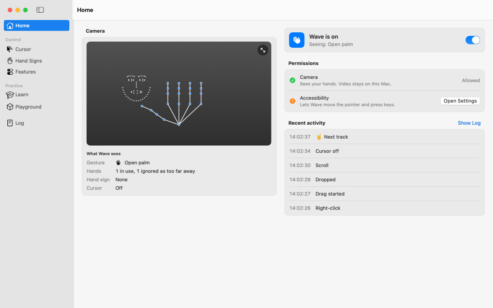
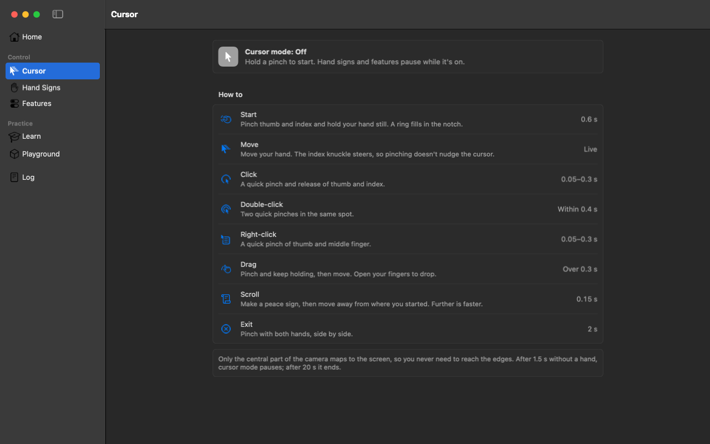
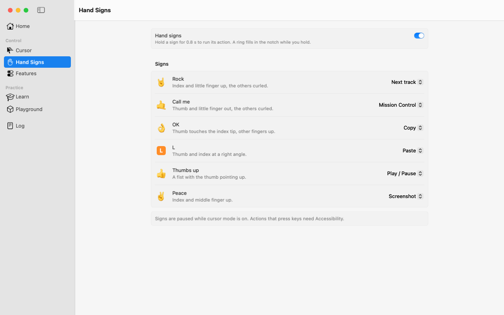
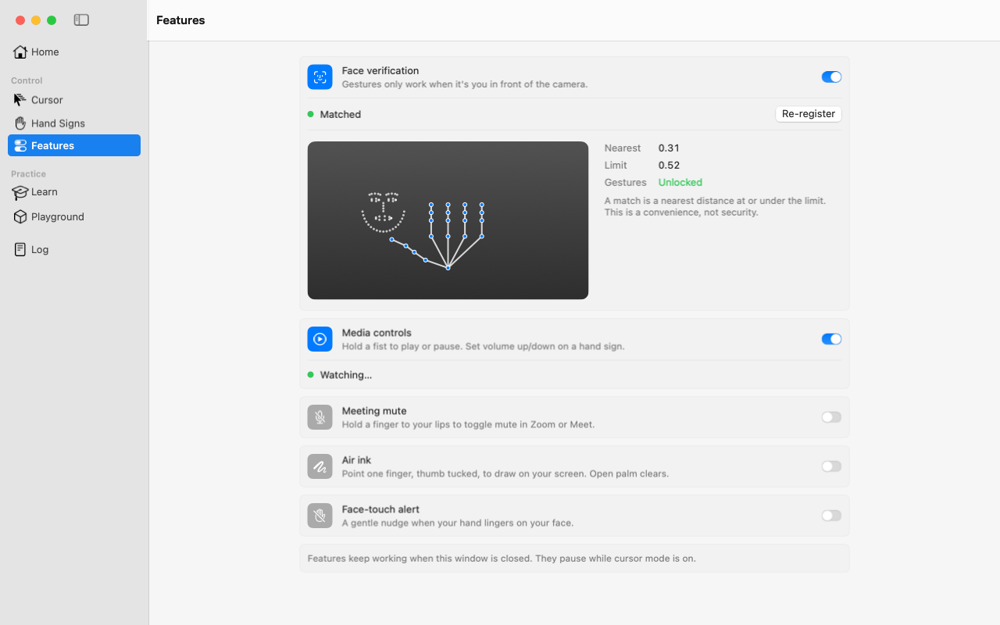
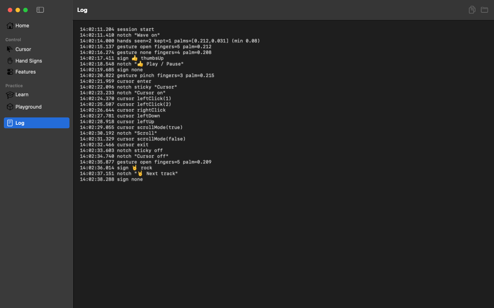
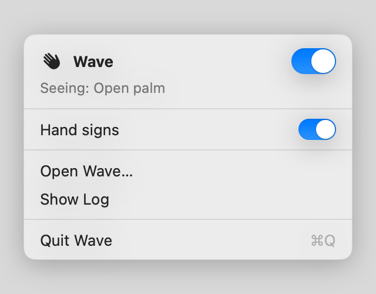
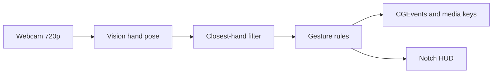

<div align="center">


# Wave

**Control your Mac with your hands. Through the webcam, on-device.**


</div>

Wave lives in your menu bar. Switch it on and your webcam turns into a trackpad and a remote: move the cursor, click, drag and scroll in the air, or hold a hand sign to pause music, take a screenshot, copy or paste. A black pill grows out of the notch to show what Wave sees and does.

## Why Wave

- **A mouse in the air.** Pinch to arm cursor mode, then point, tap and drag. No gloves, no extra hardware.
- **Hand signs for the things you do all day.** Play/pause, next track, Mission Control, screenshot, copy and paste. Reassign any of them, including to an Apple Shortcut.
- **Private by design.** Apple Vision runs on your Mac. Frames are not saved or sent anywhere.
- **A normal app.** Open it from Launchpad, Spotlight or the Dock; close the window and it keeps working from the menu bar and notch. The camera runs only while Wave is on.
- **Ignores bystanders.** Only the closest hand counts, so people behind you cannot trigger anything.

## Quick start

```sh
git clone https://github.com/srtkio/wave.git && cd wave
./build.sh
open /Applications/Wave.app   # build.sh installs it there
```

Needs macOS 15 or later and Xcode 27 with Swift 6. Click the hand icon in the menu bar, flip **Wave** on, and allow **Camera** and **Accessibility** when asked. Camera access only works from the built app bundle, not from `swift run`.

## Cursor mode

Hold a thumb and index **pinch for 0.6 s** to start. A ring fills in the notch while you hold, then the pill says **Cursor**. Other gesture features pause while it is on.

| Do this | Result |
|---|---|
| 👆 Move your hand | The **index knuckle** moves the cursor (it barely moves when your fingertips pinch, so clicks land where you aimed) |
| 🤏 Quick pinch and release (thumb + index) | Left click |
| 🤏🤏 Two quick pinches in the same spot | Double-click |
| 🖐️ Quick pinch of thumb + **middle** finger | Right click |
| ✊ Pinch and hold for over 0.3 s, then move | Drag (move windows, select text) |
| ✌️ Peace sign, then move your hand | Scroll in any direction, faster the further you move |
| 🙌 Both hands pinching, side by side, for 2 s | Exit cursor mode |

Exact timings and tracking tips are in [docs/GESTURES.md](docs/GESTURES.md).

## Hand signs

Outside cursor mode, **hold** a sign for 0.8 s. A ring fills in the notch, then the action runs.

| Sign | Default action |
|---|---|
| 👍 Thumbs up | Play / pause |
| 🤘 Rock | Next track |
| 🤙 Call me | Mission Control |
| ✌️ Peace | Full-screen screenshot, saved to your usual screenshots folder |
| 👌 OK | Copy |
| 🇱 L (thumb and index at a right angle) | Paste |

Every sign can be reassigned on the **Hand Signs** page of the window: next or previous track, volume, copy, paste, Mission Control, screenshot, nothing, or any Apple Shortcut.

## The window



A standard Mac window with a sidebar. It follows your light or dark appearance and your accent colour.

- **Home**: the Wave switch, the camera at a modest size (with a full-screen button; Esc returns), what Wave sees right now (gesture, hands in use or ignored, hand sign, cursor), a Camera and Accessibility checklist with shortcuts to System Settings, and recent activity.
- **Cursor**: how to start, move, click, double-click, right-click, drag, scroll and exit, with the exact timings, and whether cursor mode is on.
- **Hand Signs**: the master switch and one action picker per sign; the sign you are holding is marked live.
- **Features**: the toggles below. Face verification shows a small camera, the registration prompts and the live match numbers.
- **Learn**: a card per gesture that lights up when you make it.
- **Playground**: a 3D toy over the full-size camera: pinch and throw, make a fist to blast, hold an open palm to reset.
- **Log**: the session log as it is written, with Copy and Reveal in Finder.

| | |
|---|---|
|  |  |
|  |  |

Features, all off by default:

- **Face verification**: gestures only work while the registered face is in front of the camera. A convenience, not security.
- **Media controls**: hold a fist for 0.4 s to play or pause. (Volume lives on hand signs; pinch is reserved for cursor mode.)
- **Meeting mute**: a finger on your lips toggles mute in Zoom or Meet in a browser.
- **Air ink**: point one finger, thumb tucked, to draw on screen; an open palm clears. Strokes fade after 5 s.
- **Face-touch alert**: a notification when your hand touches your face.

## Menu bar



A small dropdown: the **Wave** switch with a status line ("Looking for your hand…", "Seeing: Thumbs up", "Cursor mode is on"), a **Hand signs** switch, **Open Wave…**, **Show Log** and **Quit Wave**. The camera only runs while Wave is on.

The notch HUD has three looks:

| Flash | Sticky | Progress ring |
|---|---|---|
|  |  |  |
| A result for a moment, like "Play / Pause" | Stays while a mode is on, like "Cursor" | Fills while you hold a pinch or a sign |

On Macs without a notch the pill grows out of the menu bar instead.

<br clear="right">

## Privacy

- Camera frames are processed in memory by Apple Vision on your Mac and discarded.
- The camera runs only while the Wave switch is on.
- **Camera** is needed to see your hands. **Accessibility** is needed to move the cursor and send key presses; grant it in System Settings → Privacy & Security → Accessibility.

## How it works



1. `AVCaptureSession` feeds frames to `VNDetectHumanHandPoseRequest` (up to two hands, joints under 0.3 confidence dropped).
2. Hands with a palm smaller than 8% of the frame are dropped as too far away, and the rest are sorted closest first.
3. Pure rules turn joints into gestures. Distances are relative to palm size, so they hold up as you move closer or further.
4. Cursor mode is a state machine (hands and time in, events out). Its events become CGEvents; hand signs become key presses, media keys or Apple Shortcuts.

## Self-test

```sh
swift run Wave --selftest
```

Runs the gesture rules, cursor mode, hold timers and feature logic against fake hands and fake time, with no camera. Prints `ALL PASS` when it is green.

To re-render every screenshot in `docs/screenshots/` (light and dark) without a camera:

```sh
scripts/snapshot.sh
```

It runs `Wave --snapshot` from a throwaway app bundle, because only an app opened through Finder or `open` can become active, and inactive windows draw switches grey.

## Roadmap

- [ ] Real face recognition, replacing the convenience face check
- [ ] Air instrument
- [ ] More hand signs
- [ ] Tuning thresholds on more hardware and lighting

## Project layout

```
Sources/Wave/
  WaveApp.swift          app, sidebar window, menu-bar panel
  Core/                  hand tracking, gesture rules, signs, notch HUD, key/mouse output, theme
  Features/              cursor mode, hand signs, face check, media, meeting, air ink
  Views/                 Home, Cursor, Hand Signs, Features, Learn, Playground, Log pages
  Snapshot.swift         --snapshot renderer
build.sh                 builds and signs build/Wave.app
scripts/make-icon.swift  draws the app icon
scripts/snapshot.sh      renders docs/screenshots
docs/                    GESTURES.md, icon, screenshots
PLAN.md  CORE_API.md  CHANGELOG.md
```

See [docs/GESTURES.md](docs/GESTURES.md) for the full gesture guide and [CHANGELOG.md](CHANGELOG.md) for what changed.
