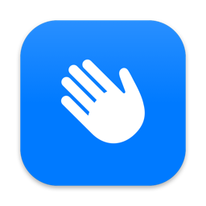
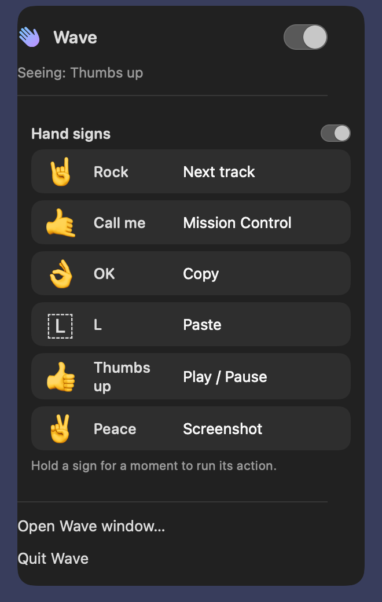
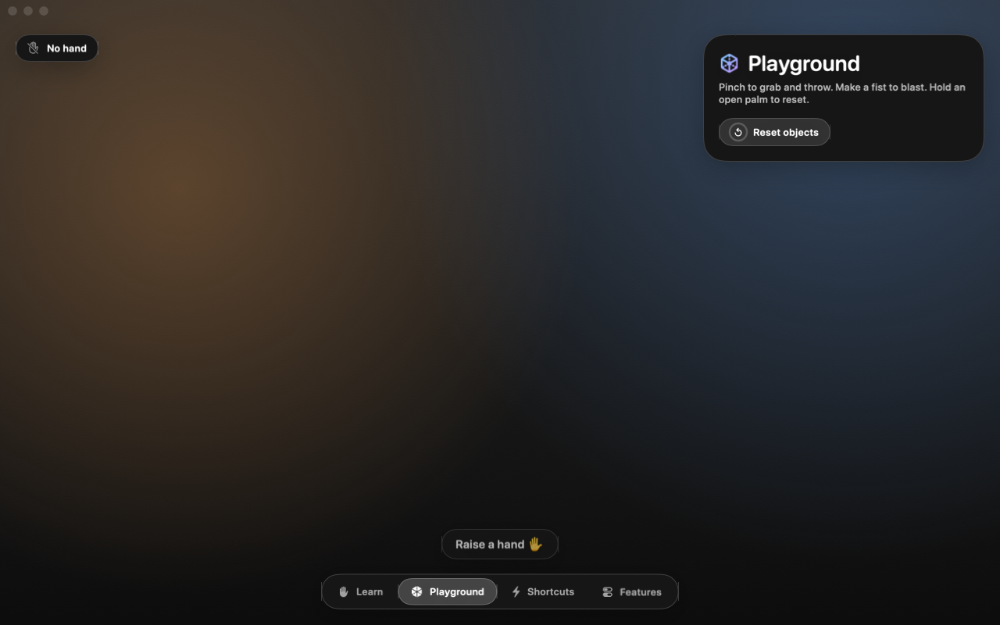
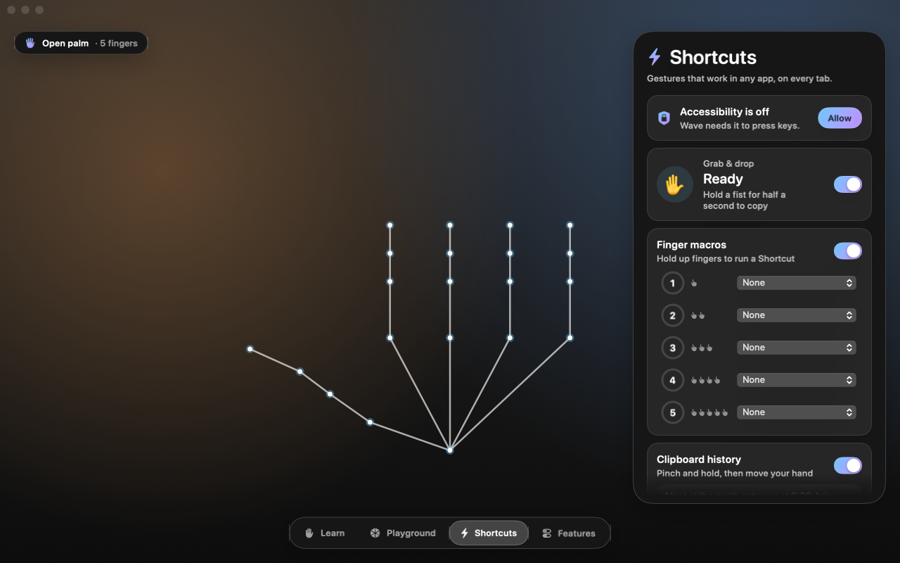
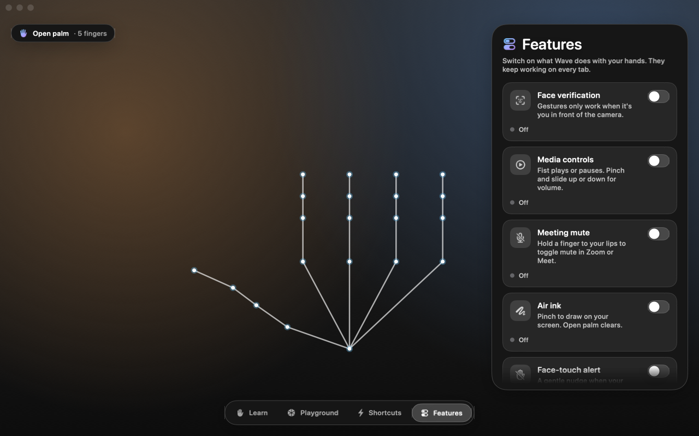
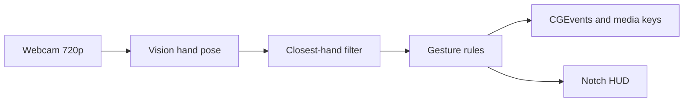

<div align="center">



# Wave

**Control your Mac with your hands. Through the webcam, on-device.**


</div>

Wave lives in your menu bar. Switch it on and your webcam turns into a trackpad and a remote: move the cursor, click, drag and scroll in the air, or hold a hand sign to pause music, take a screenshot, copy or paste. A black pill grows out of the notch to show what Wave sees and does.

## Why Wave

- **A mouse in the air.** Pinch to arm cursor mode, then point, tap and drag. No gloves, no extra hardware.
- **Hand signs for the things you do all day.** Play/pause, next track, Mission Control, screenshot, copy and paste. Reassign any of them, including to an Apple Shortcut.
- **Private by design.** Apple Vision runs on your Mac. Frames are not saved or sent anywhere.
- **A normal app.** Open it from Launchpad, Spotlight or the Dock; close the window and it keeps working from the menu bar and notch. The camera runs only while Wave is on.
- **Ignores bystanders.** Only the closest hand counts, so people behind you cannot trigger anything.

## Quick start

```sh
git clone https://github.com/srtkio/wave.git && cd wave
./build.sh
open /Applications/Wave.app   # build.sh installs it there
```

Needs macOS 15 or later and Xcode 27 with Swift 6. Click the hand icon in the menu bar, flip **Wave** on, and allow **Camera** and **Accessibility** when asked. Camera access only works from the built app bundle, not from `swift run`.

## Cursor mode

Hold a thumb and index **pinch for 0.6 s** to start. A ring fills in the notch while you hold, then the pill says **Cursor**. Other gesture features pause while it is on.

| Do this | Result |
|---|---|
| 👆 Move your hand | The **index knuckle** moves the cursor (it barely moves when your fingertips pinch, so clicks land where you aimed) |
| 🤏 Quick pinch and release (thumb + index) | Left click |
| 🤏🤏 Two quick pinches in the same spot | Double-click |
| 🖐️ Quick pinch of thumb + **middle** finger | Right click |
| ✊ Pinch and hold for over 0.3 s, then move | Drag (move windows, select text) |
| ✌️ Peace sign, then move your hand | Scroll in any direction, faster the further you move |
| 🙌 Both hands pinching, side by side, for 2 s | Exit cursor mode |

Exact timings and tracking tips are in [docs/GESTURES.md](docs/GESTURES.md).

## Hand signs

Outside cursor mode, **hold** a sign for 0.8 s. A ring fills in the notch, then the action runs.

| Sign | Default action |
|---|---|
| 👍 Thumbs up | Play / pause |
| 🤘 Rock | Next track |
| 🤙 Call me | Mission Control |
| ✌️ Peace | Screenshot |
| 👌 OK | Copy |
| 🇱 L (thumb and index at a right angle) | Paste |

Every sign can be reassigned in the menu bar: next or previous track, volume, copy, paste, Mission Control, screenshot, nothing, or any Apple Shortcut.

## Menu bar



The dropdown has:

- the **Wave on/off switch**. The camera only runs while it is on.
- a **status line**: "Looking for your hand…", "Seeing: Thumbs up", or "Cursor mode".
- the **Hand signs** section, with a master switch and one action picker per sign.
- **Open Wave window…** for the optional window below.
- **Quit Wave**.

The notch HUD has three looks:

| Flash | Sticky | Progress ring |
|---|---|---|
|  |  |  |
| A result for a moment, like "Play / Pause" | Stays while a mode is on, like "Cursor" | Fills while you hold a pinch or a sign |

On Macs without a notch the pill grows out of the menu bar instead.

<br clear="right">

## Optional window

Open it from the menu with **Open Wave window…**. Wave works fine without it.

| | |
|---|---|
|  |  |
| **Learn**: a card per gesture that lights up when you make it | **Playground**: pinch and throw a 3D cube, make a fist to blast everything away |
|  |  |
| **Shortcuts**: grab and drop, finger-count macros, clipboard history (off by default) | **Features**: the toggles below |

Features, all off by default:

- **Face check**: gestures pause when it does not see your face. A convenience, not security; real face recognition is planned.
- **Media controls**: fist plays or pauses. (Volume lives on hand signs; pinch is reserved for cursor mode.)
- **Meeting mute**: a finger on your lips toggles mute in Zoom or Meet in a browser.
- **Air ink**: draw on screen with a pinch; strokes fade after 5 s.
- **Face-touch alert**: a notification when your hand touches your face.

## Privacy

- Camera frames are processed in memory by Apple Vision on your Mac and discarded.
- The camera runs only while the Wave switch is on.
- **Camera** is needed to see your hands. **Accessibility** is needed to move the cursor and send key presses; grant it in System Settings → Privacy & Security → Accessibility.
- The clipboard history in the optional window stays in memory only.

## How it works



1. `AVCaptureSession` feeds frames to `VNDetectHumanHandPoseRequest` (up to two hands, joints under 0.3 confidence dropped).
2. Hands with a palm smaller than 8% of the frame are dropped as too far away, and the rest are sorted closest first.
3. Pure rules turn joints into gestures. Distances are relative to palm size, so they hold up as you move closer or further.
4. Cursor mode is a state machine (hands and time in, events out). Its events become CGEvents; hand signs become key presses, media keys or Apple Shortcuts.

## Self-test

```sh
swift run Wave --selftest
```

Runs the gesture rules, cursor mode, hold timers and feature logic against fake hands and fake time, with no camera. Prints `ALL PASS` when it is green.

To re-render every screenshot in `docs/screenshots/` without a camera:

```sh
swift run Wave --snapshot docs/screenshots
```

## Roadmap

- [ ] Real face recognition, replacing the convenience face check
- [ ] Air instrument
- [ ] More hand signs
- [ ] Tuning thresholds on more hardware and lighting

## Project layout

```
Sources/Wave/
  WaveApp.swift          menu-bar app, menu panel, optional window
  Core/                  hand tracking, gesture rules, signs, notch HUD, key/mouse output, theme
  Features/              cursor mode, hand signs, face check, media, meeting, air ink
  Views/                 Learn, Playground, Shortcuts, Features tabs
  Snapshot.swift         --snapshot renderer
build.sh                 builds and signs build/Wave.app
scripts/make-icon.swift  draws the app icon
docs/                    GESTURES.md, icon, screenshots
PLAN.md  CORE_API.md  CHANGELOG.md
```

See [docs/GESTURES.md](docs/GESTURES.md) for the full gesture guide and [CHANGELOG.md](CHANGELOG.md) for what changed.
