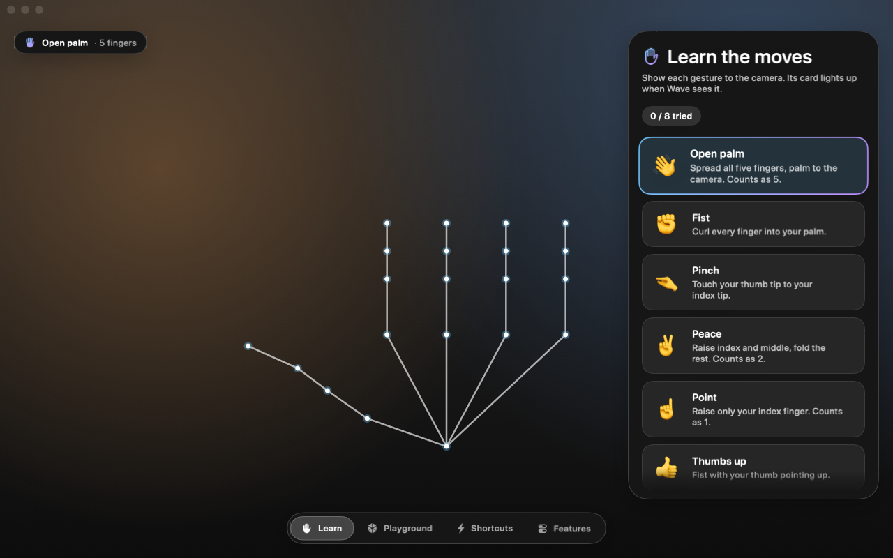

# Wave

Wave turns your webcam into a hand-gesture remote for your Mac: copy and paste with a fist, run Apple Shortcuts with your fingers, and play with 3D objects in the air.



## Tabs

Switch tabs with the floating bar at the bottom, or with ⌘1 to ⌘4.

- **Learn**: a gallery of gestures. Make one and its card lights up, so you can try them out.
- **Playground**: 3D objects over the camera feed. Pinch to grab and throw a cube, make a fist to blast everything away.
- **Shortcuts**: a fist followed by an open hand copies or pastes. Hold 1 to 5 fingers to run an Apple Shortcut of your choice. Clipboard history keeps the last five items.
- **Features**: optional toggles for face verification, media controls, meeting gestures, air ink, and a face-touch alert.

## Gestures

| Gesture | How to make it | What it does |
|---|---|---|
| Open | All five fingers spread | Ends a fist-to-open copy/paste sequence |
| Fist | Fingers curled into a fist | Starts copy/paste; blasts objects in Playground |
| Pinch | Thumb and index finger touching | Grabs objects; starts clipboard history |
| Peace | Index and middle fingers up | Recognized in Learn |
| Point | Index finger up | Recognized in Learn |
| Thumbs up | Thumb up, other fingers closed | Recognized in Learn |
| 1 to 5 fingers | Hold that many fingers for about a second | Runs the Shortcut assigned to that count |

## Requirements

- macOS 15 or later
- Xcode 27 with Swift 6

## Build and run

```sh
./build.sh && open build/Wave.app
```

Run the self-test with:

```sh
swift run Wave --selftest
```

Render every tab to PNGs without a camera (used for `docs/screenshots/`):

```sh
swift run Wave --snapshot docs/screenshots
```

## Permissions

- **Camera**: asked on first launch. Required for hand tracking.
- **Accessibility**: needed to send key presses and media keys. Grant it in System Settings → Privacy & Security → Accessibility.

Every rebuild re-signs the app, so macOS may ask for the camera again, and Accessibility can silently stop working. If so, remove Wave from the Accessibility list and add it back.

## Privacy

Everything runs on your Mac. Hand tracking and face checks use Apple's Vision framework on-device, and nothing is uploaded. The face check is a convenience to pause gestures when you are not in front of the screen. It is not security; use Touch ID or your password for anything sensitive.

## Project layout

```
Sources/Wave/
├── Core/       hand tracking, gesture rules, output (keys, media, shortcuts)
├── Views/      Learn, Playground, Shortcuts, Features tabs
└── Features/   optional features behind the Features toggles
Resources/      Info.plist
scripts/        make-icon.swift (app icon, run by build.sh)
docs/screenshots/
```
